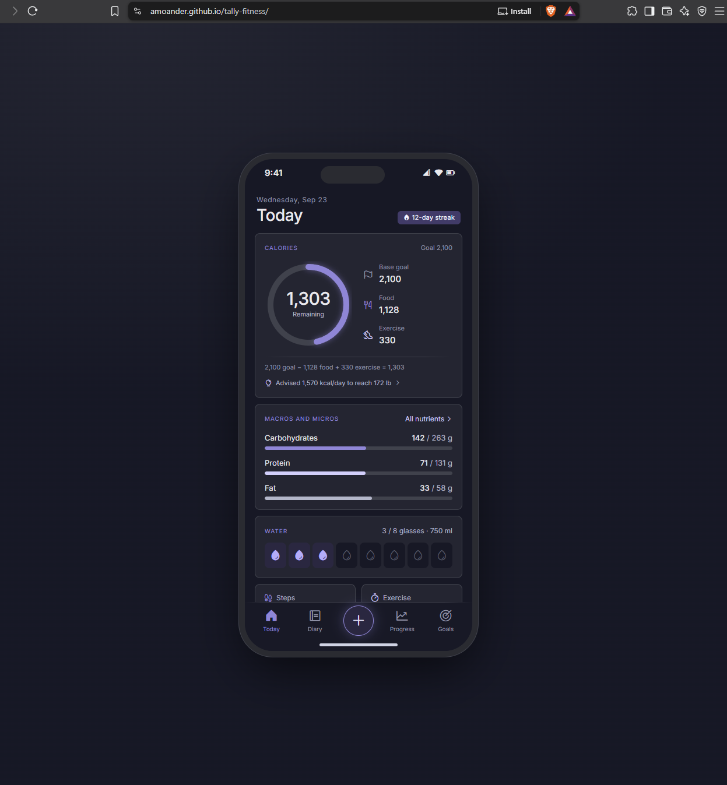

# Tally Fitness

A simple fitness tracker that runs in your browser and installs on your phone like an app.

**Live app:** https://amoander.github.io/tally-fitness/

## Features

- Tracks daily, weekly, monthly and yearly macro and micro nutrients, hydration, weight, and workouts.
- Estimates daily macro and micro nutrient needs based off age, height, weight, and activity level. 
- Search built-in foods and your own; add a free USDA key in Goals to also search USDA FoodData Central (picked foods are saved for later).
- Add your own food from the search screen; it's saved for later searches and included in backups.
- Scan food barcodes with your camera (or type the number) to lookup nutrient data.
- Works offline-style from your home screen (Add to Home Screen)
- Delete a single weigh-in or clear the whole weight log (both ask before deleting)
- Weigh-ins are saved with their date; logging again the same day replaces it
- A new day starts automatically at midnight; past days are kept in Week history with what you ate
- Step back through past days in the Diary to see what you logged (view only)
- Download a backup of your data and restore it on any device (invalid or damaged backup files are rejected without changing your data)

## Privacy

Your food and workout logs are saved only in your own browser (localStorage).
No account is needed. Backup files contain your logs and are not encrypted, so store them
somewhere private and don't share them.

When you scan or type a barcode, only that barcode number is sent to
[Open Food Facts](https://world.openfoodfacts.org/), a free public food database,
to look up nutrition info.

If you add a USDA key, your search words and the key are sent to
[USDA FoodData Central](https://fdc.nal.usda.gov/) when you press Search.
The key is stored only on this device and isn't included in backups.

## Built with

- HTML, CSS, and JavaScript, with no build step
- Hosted free on GitHub Pages
- Built with help from Claude, shipped with Git branches and pull requests

## Install on your phone

1. Open the live link in your phone's browser
2. iPhone: Share, then Add to Home Screen. Android: menu, then Add to Home screen